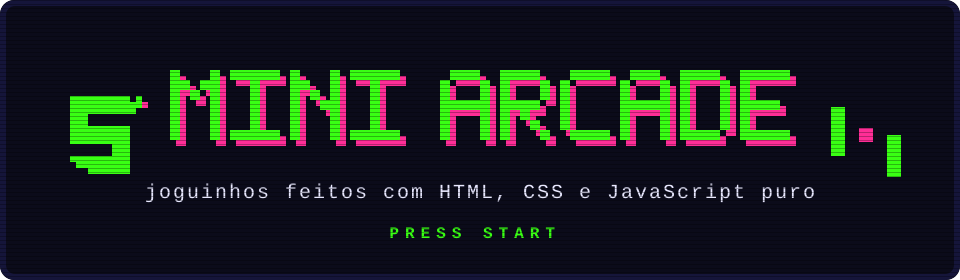
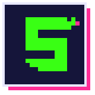
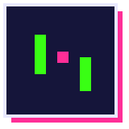
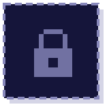
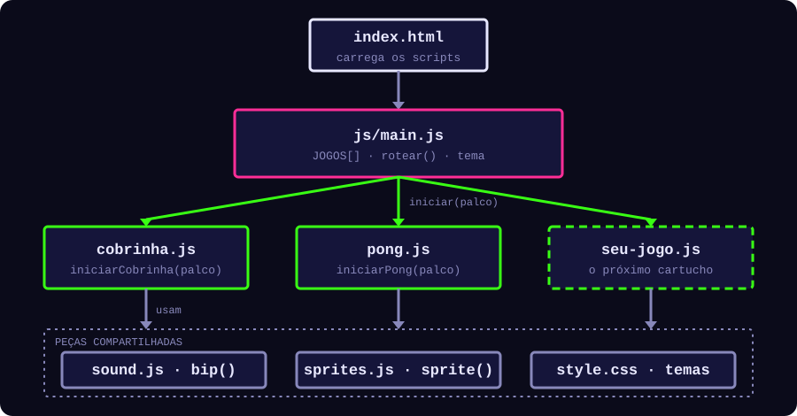

<p align="center">
  
</p>

<p align="center">
  Uma coleção de joguinhos retrô que roda direto no navegador, sem framework, sem build e sem dependências.<br>
  Projeto de estudo pessoal: cada jogo novo é um pretexto para aprender uma coisa nova.
</p>

---

## Jogos

|  | Jogo | Como jogar | Arquivo | O que ele ensinou |
|:-:|---|---|---|---|
|  | **Cobrinha** | Setas ou WASD · deslizar o dedo · D-pad | [`cobrinha.js`](js/games/cobrinha.js) | Grade, loop com `setTimeout`, fila de comandos, recorde no `localStorage` |
|  | **Pong** | Setas ou W/S · arrastar o dedo · ▲ ▼ | [`pong.js`](js/games/pong.js) | Loop com `requestAnimationFrame`, tempo delta, colisão, IA simples |
|  | _Próximo jogo_ | — | — | — |

<!-- NOVO JOGO: copie uma linha da tabela acima, troque o ícone (assets/), o nome, os controles, o arquivo e o aprendizado. -->

## Como rodar

Não tem instalação. Abra o `index.html` no navegador e pronto.

Se preferir um servidor local (útil para testar no celular, na mesma rede Wi-Fi):

```bash
python3 -m http.server 8000
# abra http://localhost:8000
```

> A fonte pixel (**Press Start 2P**) vem do Google Fonts. Sem internet, o jogo funciona normalmente e usa `Courier New` no lugar.

## Estrutura do projeto

```
mini-arcade/
├── index.html            # esqueleto da página e ordem de carregamento dos scripts
├── README.md
├── assets/               # imagens SVG usadas neste README
├── css/
│   └── style.css         # temas (variáveis CSS), layout, botões, D-pad
└── js/
    ├── main.js           # lista JOGOS[], menu, rotas (#hash) e troca de tema
    ├── sound.js          # bip(): sons retrô com Web Audio
    ├── sprites.js        # SPRITES{} em texto + sprite(): vira SVG pixel art
    └── games/
        ├── cobrinha.js   # iniciarCobrinha(palco)
        └── pong.js       # iniciarPong(palco)
```

## Como é construído

<p align="center">
  
</p>

### Tecnologias

| Peça | Para que serve aqui |
|---|---|
| **HTML5** | Uma única página; o menu e o jogo são duas `<section>` que alternam o atributo `hidden` |
| **CSS3** | Variáveis CSS para os temas, `grid` no menu, `@media (pointer: coarse)` para mostrar o D-pad só no celular, efeito CRT com `repeating-linear-gradient` |
| **JavaScript (ES6+)** | Sem módulos e sem bibliotecas: scripts comuns carregados em ordem |
| **Canvas 2D** | Desenho dos jogos (`fillRect`, texto, transparência) |
| **SVG gerado por código** | Os ícones do menu são montados a partir de sprites escritos em texto |
| **Web Audio API** | Sons de 8 bits com um oscilador (`square`, `sawtooth`) |
| **Pointer Events** | Mouse, toque e caneta com o mesmo código (arrastar, deslizar, segurar botão) |
| **localStorage** | Tema escolhido e recordes, sempre dentro de `try/catch` |

### A ideia central: o contrato do jogo

O `main.js` não sabe nada sobre os jogos. Ele só conhece esta regra:

> Todo jogo é uma função `iniciarXxx(palco)` que **monta o próprio HTML dentro de `palco`** e **devolve uma função de limpeza**.

```js
function iniciarMeuJogo(palco) {
  palco.innerHTML = `...`;          // 1. monta a tela
  // ... lógica, eventos, loop ...
  return () => {                    // 2. devolve a limpeza
    // cancela timers e remove os listeners
  };
}
```

Quando o jogador volta ao menu, o `rotear()` chama essa limpeza. Sem isso, o loop e os eventos do jogo anterior continuariam rodando em segundo plano.

### Rotas com `#hash`

Clicar num cartucho só faz `location.hash = "pong"`. O evento `hashchange` dispara o `rotear()`, que acha o jogo na lista `JOGOS`, limpa o anterior e inicia o novo. Isso dá botão voltar do navegador e link direto para cada jogo (`index.html#pong`) sem nenhuma biblioteca de rotas.

### Sprites em texto

Cada sprite é uma lista de strings; cada caractere é um pixel:

```js
pong: [
  ".##.........",
  ".##..xx.....",   // "#" = cor principal · "x" = destaque · "." = vazio
  ".##......##.",
  // ...
]
```

A função `sprite("pong", 3)` transforma isso em um `<svg>` com um `<rect>` por pixel, usando as cores do tema atual. Por isso os ícones trocam de cor junto com o tema claro/escuro.

### Temas

Todas as cores vivem em variáveis CSS (`--accent`, `--screen`, `--food`...) no `:root`. O tema escuro é neon; o claro usa a paleta verde de Game Boy. Os jogos leem as cores com `getComputedStyle` na hora de desenhar, então mudar o tema muda o jogo sem recarregar. O `main.js` avisa os jogos com o evento `tema`.

## Como adicionar um novo jogo

1. **Crie o arquivo** `js/games/meujogo.js` com a função `iniciarMeuJogo(palco)` (veja o contrato acima). Use o Pong ou a Cobrinha como molde.
2. **Desenhe o ícone** em `js/sprites.js`, dentro de `SPRITES`, com caracteres.
3. **Registre na lista** `JOGOS` do `js/main.js` (troque um cartucho "EM BREVE" ou adicione um novo):

   ```js
   {
     id: "meujogo",
     nome: "MEU JOGO",
     icone: sprite("meujogo", 3),
     desc: "Uma frase curta.",
     iniciar: iniciarMeuJogo,
   },
   ```
4. **Carregue o script** no `index.html`, **antes** do `main.js` (ele precisa da função já definida):

   ```html
   <script src="js/games/meujogo.js"></script>
   <script src="js/main.js"></script>
   ```
5. **Atualize este README:** a tabela de jogos, o roadmap e a seção de aprendizados.

### Checklist de um bom jogo

- [ ] Devolve a função de limpeza (timers, `requestAnimationFrame`, listeners de `document` e `window`)
- [ ] Funciona com teclado **e** com toque
- [ ] Usa `cor("--accent")` e companhia, nada de cores fixas
- [ ] Redesenha no evento `tema` (ou desenha todo quadro)
- [ ] Pausa e reinicia com **Espaço**
- [ ] Guarda o recorde em `localStorage` com a chave `arcade:<id>`

## Roadmap

A ordem é livre; o que eu estiver com vontade de aprender no momento.

- [x] Cobrinha
- [x] Pong
- [ ] Jogo da Velha (com IA minimax)
- [ ] Memória (pares)
- [ ] Breakout
- [ ] Campo Minado
- [ ] 2048
- [ ] Flappy
- [ ] Dino Runner
- [ ] Space Invaders
- [ ] Tetris
- [ ] ...

## O que estou aprendendo

Este projeto é de estudo pessoal, então o objetivo não é só terminar os jogos, é entender o que cada um ensina. Esta seção cresce junto com o projeto.

**Fundamentos de jogos**
- O que é um _game loop_ e as duas formas de fazer: passos a intervalos fixos (`setTimeout`, na Cobrinha) e quadro a quadro (`requestAnimationFrame`, no Pong)
- Tempo delta: mover as coisas por segundo, e não por quadro, para o jogo andar igual em qualquer tela
- Máquina de estados simples: `pronto → jogando → pausado → fim`
- Colisão com retângulos, ângulo de rebote e aumento gradual de dificuldade
- Uma IA "burra de propósito" (atraso e erro de mira) para o jogo ser vencível

**JavaScript**
- Funções que guardam estado (closures) e devolvem uma função de limpeza
- Por que remover `addEventListener` ao sair de uma tela
- Organizar um projeto sem framework: separar menu, jogos e utilidades
- Guardar dados no navegador com segurança (`try/catch` em volta do `localStorage`)

**Web e interface**
- Canvas 2D e a diferença entre o tamanho interno e o tamanho no CSS
- Pointer Events e `touch-action: none` para jogar no celular
- Temas com variáveis CSS e `prefers-color-scheme`
- Gerar SVG por código (pixel art a partir de texto)
- Som sem arquivos de áudio, só com Web Audio

**Para aprender nos próximos jogos**
- Minimax e árvores de decisão (Jogo da Velha)
- _Flood fill_ (Campo Minado)
- Rotação de matrizes e detecção de linhas (Tetris)
- Animação por quadros de sprite (Space Invaders)
- _(adicione aqui o que cada jogo novo te ensinar)_

## Ideias para depois

- Salvar o recorde também no Pong (contra a CPU, por exemplo, em vitórias seguidas)
- Som liga/desliga no menu
- Modo para dois jogadores no Pong
- Publicar com GitHub Pages

---

<p align="center">
  <sub>Feito com HTML, CSS e JavaScript · © 2026 Mini Arcade</sub>
</p>